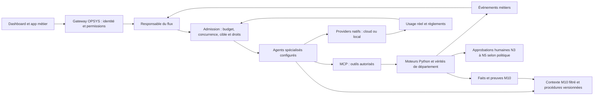

# Recherche core, runtimes, mémoire procédurale et économie de tokens

**30 septembre 2026 — PREUVE documentaire et statique.** Base OPSYS : `2e56c0d5605dfe575bde9244f38924d5390f2674`. Aucun code du core, de Hermes ou des candidats n'a été exécuté, installé ni benchmarké. Les écritures de ce volet sont exclusivement sous `/workspace/restructuration-opsys-2026-09-30`. Les documents/règles OPSYS ont été modifiés en parallèle par le coordinateur ; ce rapport ne revendique donc pas un worktree global propre.

**Recommandation : continuer le fork dur OPSYS-CORE déjà greffé, compléter ses propriétaires existants et récupérer des composants étroits.** La recherche ne démontre aucun gain qui justifie de remplacer ce core par Hermes ni d'ajouter une seconde boucle d'agents. La priorité est de relier les dépenses réelles aux départements et d'admettre chaque appel sous budget, puis de composer des agents spécialisés autour des flux d'affaires. Les candidats sont des ingrédients à qualifier, pas une liste de services à installer.

Exa a fourni 35 résultats demandés sur six requêtes couvrant identité, mémoire, coût/compaction et connecteurs. Les résultats ont servi à découvrir les sources, jamais à certifier une capacité. La validation porte sur **13 dépôts GitHub et un dépôt GitLab**, avec commits fixés, métadonnées, fichiers de licence et interfaces. Les README contiennent des promesses commerciales : aucun pourcentage d'économie, performance fournisseur ou résultat de benchmark n'est repris comme un résultat OPSYS. Preuves : [index des dépôts](preuves-core/index.json), [fichiers et empreintes](preuves-core/fichiers-index.json), [recherches Exa](preuves-core/recherches-exa.json), [source GitLab](preuves-core/gitlab-primary.json), [Hermes](preuves-hermes/source-manifest.json).

> Note du coordinateur après collecte : ADR-0008 définit le choix natif, mais le générateur
> Python et les installateurs routent encore LiteLLM par défaut. Voir l'écart dans [R16](README.md).
> La recommandation d'architecture de ce rapport ne prouve pas cette migration exécutée.

## Ce que désigne « OpenClaw2 »

Dans les documents OPSYS, « OpenClaw2 » désigne **la base importée depuis `openclaw/openclaw`**, version `v2026.9.6` : ADR-0008 emploie ce nom dans le mandat puis choisit cette release ; `core/PROVENANCE.md` donne le tag annoté `ce5bbdc244ee937246cc1700d1b224d020c3b599` et le commit `eb377ac59e6c9fd6c7705028034812becf00271b`. Aucun deuxième dépôt n'est identifié par ce contrat de provenance.

Le projet officiel actuel se nomme [OpenClaw](https://github.com/openclaw/openclaw/blob/537c33e4118ae31a96d0d0c3aee317963058bbd9/README.md). Une recherche GitHub sur « OpenClaw2 » retourne de nombreux projets personnels et noms contenant OpenClaw2026 ; elle n'établit pas leur filiation officielle. [Résultat brut](preuves-core/openclaw2-recherche-github.json). **Identifié pour OPSYS ; ambigu comme nom public.** Il faut écrire « base OpenClaw `openclaw/openclaw`, fork OPSYS, tag/commit » dans les prochaines décisions et ne pas chercher à installer un produit tiers « OpenClaw2 » sans URL du propriétaire.

L'amont fraîchement observé est `537c33e4118ae31a96d0d0c3aee317963058bbd9`, daté du 30 septembre à 11:40:50 UTC, et publie `v2026.9.7`. Sa [licence lue](https://github.com/openclaw/openclaw/blob/537c33e4118ae31a96d0d0c3aee317963058bbd9/LICENSE) reste MIT avec renvoi aux notices. L'API SPDX retourne `NOASSERTION` : le texte de licence fait foi. Ce constat n'autorise pas une mise à jour automatique du fork. La nouvelle release est une source de correctifs à examiner individuellement, avec compatibilité des greffes et preuves CI.

## Existant adopté et limites à garder visibles

Le core fournit déjà agents multiples, sous-agents natifs, modèles cloud/locaux, repli, cache de prompts, compaction, MCP, planificateur, Control UI et comptabilité de sessions. Le fork contient les composants Pi dans `core/packages/ai` et `core/packages/agent-core`, `tokenjuice`, mémoire SQLite/FTS/vectorielle, diagnostics OpenTelemetry et le contrat `ContextEngine`. Les greffes OPSYS ajoutent identité d'appareil, moteur M10, garde N3+, supervision Python, CLI et migration d'instance. **Ce sont des surfaces disponibles dans la source ; leur existence ne prouve pas le parcours complet de chaque département.** La CI du core auditée et les défauts sont détaillés dans [l'audit ciblé](audit/core.md).

ADR-0008 retire **LiteLLM du chemin par défaut** : providers natifs pour éviter une brique d'installation. L'adaptateur LiteLLM et son synchroniseur restent présents comme voie optionnelle/historique. Proposer LiteLLM « déjà obligatoire » ou ajouter Bifrost sans bénéfice établi contredirait cette décision.

Deux raccords précis méritent la priorité :

- `src/opsys/jetons.py` gère budgets/comptabilité et `Capacites` refuse certains outils lorsque le budget est déjà épuisé. Les alimentations visibles sont le plugin Hermes optionnel et la synchronisation LiteLLM. La documentation `ECONOMIE-TOKENS.md` reconnaît l'absence de branchement natif OpenClaw vers cette table. **Un refus d'outil MCP après dépense n'est pas une admission avant chaque appel modèle.**
- `openclaw.py` génère dix agents de département, `agents.ownership="explicit"` et `contextPruning.mode="cache-ttl", ttl="1h"`. Les slots/compaction et les wrappers de cache existent. `tokenjuice` est conservé mais la génération ne prouve pas qu'il soit activé. Il compresse les sorties exec/bash, pas les contrats JSON du moteur métier. Avant toute activation : mesurer ce qu'il réduit et ce qu'il protège.

Les défauts d'autorité et de contexte observés doivent précéder l'élargissement des agents : CLI opérateur effaçable depuis le shell, cible d'affaire non liée à la garde, configuration invalide permissive et reprise du superviseur. Ajouter de la délégation à ces voies augmente la surface d'erreur sans améliorer leur garantie.

## OpenClaw et Hermes : composants réels, pas choix fondé sur le langage

[Hermes](https://github.com/NousResearch/hermes-agent/commit/f42f579cf8bac4918ac9599bece71618afadd846) a été fixé à `f42f579cf8bac4918ac9599bece71618afadd846`, committer 30 septembre 04:59:14 UTC ; MIT vérifiée. Dernière release interrogée : `v2026.9.24`, du 24 septembre. [Notes détaillées et 34 sources](hermes-notes.md).

| Dimension | OPSYS forké d'OpenClaw | Hermes primaire | Conséquence |
|---|---|---|---|
| Boucle/transport/interface | Node/TypeScript, Gateway/appairage/MCP/Control UI déjà raccordés à OPSYS | `AIAgent`, plugins, Gateway/TUI/web et transports Python | Garder un seul runtime d'agents ; ne pas recréer les raccords mobile/métier |
| Mémoire native | SQLite, recherche hybride, cache, dreaming et slot de contexte ; M10 distinct | Notes `MEMORY.md`/`USER.md` bornées, session search FTS5 ; providers extensibles | Comparer les garanties précises ; « Hermes n'a que deux fichiers » simplifie trop |
| Extension mémoire | `ContextEngine` avec ingestion, assemblage, compaction, commit et délégation | `MemoryProvider`/`MemoryManager`, `prefetch`, `turn_author`, changements de session, délégation, checkpoints | Reprendre des contrats dans les propriétaires OPSYS, sans installer le manager Hermes |
| Langage/version | Python métier séparé, déclaré `>=3.11`, CI Python 3.12 ; Node core | `pyproject` explique que le runtime courant **supporte Python 3.14**, malgré bornes héritées `>=3.11,<3.15` | « Déjà Python donc migration facile » est faux : runtime, dépendances et environnements changent |
| Cache/délégation | Wrappers et sous-agents natifs déjà présents | Frontières statiques de cache, handles de délégation, annulation/cost settlement | Sources de tests et d'invariants ; pas deuxième ordonnanceur |
| Installation/update | Installer OPSYS `uv`+pnpm+service, superviseur propre | Admission par type d'installation, staging et drainage des tours | Adapter les invariants ; ne pas copier un second updater propriétaire |

Les interfaces riches Hermes existaient déjà au commit R2 du 27 septembre : `memory_provider.py`, `subagent_lifecycle.py` et `prompt_caching.py` sont **identiques octet pour octet** au HEAD frais. [Comparaison](preuves-hermes/comparison-2026-09-27.json). La recherche précédente doit être complétée ; il ne faut pas inventer une avancée apparue depuis.

**Greffe Hermes la plus utile : checkpoint durable avant compression.** [MemoryProvider](https://github.com/NousResearch/hermes-agent/blob/f42f579cf8bac4918ac9599bece71618afadd846/agent/memory_provider.py) et [MemoryManager](https://github.com/NousResearch/hermes-agent/blob/f42f579cf8bac4918ac9599bece71618afadd846/agent/memory_manager.py) distinguent rappel, observation de tour et checkpoint versionné. Le contrat APIv2 peut refuser une compression avec perte sans checkpoint. Mais le réglage est off par défaut et aucun provider bundlé n'annonce APIv2 ; ce n'est pas une garantie prête à activer. Surtout, son payload exclut résultats d'outils/tool_calls/système/anciens résumés : OPSYS doit archiver séparément les preuves déterministes de l'affaire. Copier ce filtre ferait perdre les éléments qui établissent une estimation ou une opération comptable.

Autres ingrédients ciblés : provenance/staging des skills ; préfixes de prompt stables ; droits enfants comme sous-ensemble, handles d'annulation et coûts agrégés ; admission d'update sur provenance et drainage. Leur coût d'adaptation est **moyen** : les classes Python dépendent de `AIAgent`, `PluginContext`, homes et managers Hermes. Porter un petit algorithme pur ou un contrat en TypeScript est possible avec attribution ; ces classes ne sont pas des bibliothèques Node interchangeables.

## Candidats qualifiés

Coût d'adaptation : **faible** = paramétrage/contrat déjà compatible ; **moyen** = adaptateur, migrations et tests de raccord ; **élevé** = processus/base/runtime supplémentaires ou nouvelle autorité. Ces termes décrivent le travail, sans chiffrage d'heures ni note de popularité. Les licences ci-dessous ont été lues dans les fichiers primaires ; les dépendances, modèles téléchargés et sous-dossiers commerciaux demandent leur propre qualification avant redistribution.

| Brique, état | Licence / source fixée | Interface ou paths récupérables | Adaptation et décision |
|---|---|---|---|
| **Pi** — composant déjà repris | MIT ; `badlogic/pi-mono` redirige désormais vers [`earendil-works/pi`](https://github.com/earendil-works/pi/commit/d2931ad3d5bf6936fbdfa5dfc81fb32f875499b2), 30 sept. ; release `v0.99.1` le 29 | `packages/ai/src/types.ts`, `packages/agent/src/agent.ts` ; core possède déjà ses équivalents | Faible pour un correctif ciblé, élevé pour remplacer les packages vendored. Conserver les propriétaires actuels, examiner patches provider/cache à la pièce |
| **Agent Skills** — format déjà proche des skills OPSYS ; validateur candidat | Apache-2.0 ; [`69ef37e…`](https://github.com/agentskills/agentskills/commit/69ef37e9424c0a7ea9dd2293b559e43ec8176379), 9 août | `docs/specification.mdx`, `skills-ref/src/skills_ref/{validator,prompt,parser}.py` ; metadata → SKILL.md → ressources | Faible pour valider les paquets en CI ; moyen pour registre/version/permissions. Premier choix pour procédures portables. La licence de la spécification ne couvre pas les scripts tiers de chaque skill |
| **Lossless-claw** — candidat de compaction, pas encore adopté | MIT ; [`e05d8d3…`](https://github.com/Martian-Engineering/lossless-claw/commit/e05d8d34b2a44fdef556ce95dd90115b46630200), 28 sept. ; `v1.1.1` le 28 | `src/engine.ts`, `src/compaction.ts`, `src/store/`, `src/plugin/index.ts` ; DAG de résumés reliés aux messages, `lcm_grep`, expansion | Moyen/élevé : slot unique `contextEngine`, migrations/transcripts/rétention/workers. Pilote après correction M10 ; aucune installation directe remplaçant le slot `opsys` |
| **LangMem** — candidat d'apprentissage procédural hors chemin critique | MIT ; [`9d033b4…`](https://github.com/langchain-ai/langmem/commit/9d033b47d9ce53e37e92c92241b0496c0278932e), 9 sept. ; package source `0.0.30`, aucune release API retournée | `create_prompt_optimizer` (`gradient`, `metaprompt`, `prompt_memory`), `src/langmem/knowledge/`, `short_term/summarization.py` | Moyen, Python compatible mais dépendances LangChain/LangGraph/Trustcall/LangSmith. Évaluer primitives isolées ; ne pas adopter `create_react_agent` comme deuxième agent |
| **Hindsight** — réserve pour mémoire riche, pas remplacement M10 | MIT ; [`d56c4ac…`](https://github.com/vectorize-io/hindsight/commit/d56c4acdf59c41957613d399094cdf8c489b060c), 30 sept. ; `v0.10.2` le 29 | `retain/recall/reflect`, `hindsight_api/engine/retain`, `engine/reflect`, budgets et banque isolée | Élevé : serveur PostgreSQL/pgvector ou Oracle, extraction/réflexion LLM et nouvelles politiques. Étudier rappel/consolidation seulement ; M2/M5 et événements restent vérité |
| **Bifrost** — alternative gateway à mesurer, différée | Apache-2.0 ; [`19ecdb5…`](https://github.com/maximhq/bifrost/commit/19ecdb510bfb3971a7d680f33e17280187e379f4), 30 sept. ; releases modulaires le 29 | API compatible OpenAI, `plugins/governance/{main,tracker,resolver}.go`, virtual keys, budget, cache | Élevé : service Go, clés et autorités en plus. Pas défaut OPSYS : providers natifs déjà là. Budget doc admet dépassement d'un appel ; OSS multinœud non supporté |
| **sqlite-vec** — déjà adopté (`0.1.9` dans core) | MIT **ou** Apache-2.0 ; [`04d28bd…`](https://github.com/asg017/sqlite-vec/commit/04d28bd21773981e2d266bbf6aa4efbd011eb4f6), 18 mai ; dernières releases interrogées pré-v1 alpha | Extension C, bindings Node/Python ; index local existant | Faible pour conserver l'existant ; migrations/binaires et dimensions à vérifier avant upgrade. Pas de nouvelle DB vectorielle obligatoire ; ne pas choisir une alpha seulement parce qu'elle est dernière |
| **uv** — adopté pour installer Python métier | MIT **ou** Apache-2.0 ; [`06fdf0c…`](https://github.com/astral-sh/uv/commit/06fdf0cdb591adae479feb5b769b0213eabb229c), 30 sept. ; `0.12.21` le 29 | Installer standalone et Python géré ; `docs/reference/installer.md` | Faible : fixer version/origine/artefacts et maintenir `uv.lock`. Le code Rust n'a pas à entrer dans OPSYS ; distribuer l'outil épinglé selon sa licence |
| **Pixi** — alternative distribution scientifique, différée | BSD-3-Clause ; [`81264a2…`](https://github.com/prefix-dev/pixi/commit/81264a2a914b25e21df4d891889a0495a6269b70), 30 sept. ; `v0.81.0` le 15 | Manifest/env/tasks multiplateformes, conda+PyPI | Moyen/élevé : deuxième résolution/environnement à maintenir. À retenir seulement si roues uv ne couvrent pas les dépendances natives M3/M4/M6 ; pas ajouter à pnpm+uv par habitude |
| **Obot MCP Gateway** — contrôle connecteurs différé | MIT ; [`fb4b094…`](https://github.com/obot-platform/obot/commit/fb4b094cc1643ae5b47dff65cd6e16a5c2606b95), 30 sept. | `docs/docs/concepts/mcp-gateway.md`, OAuth/refresh, serveurs isolés, filtres, vMCP streamable HTTP | Élevé : service Go, conteneurs/OAuth/identités en plus. Le Gateway OPSYS possède déjà MCP et autorisation ; utile seulement si besoin prouvé d'hébergement de nombreux connecteurs non fiables |
| **GitLab MCP officiel** — connecteur développement candidat | Repo [`2d1f3c2…`](https://gitlab.com/gitlab-org/gitlab/-/commit/2d1f3c266d04c069c98349923c86ac636bd59744), acquis le 30 sept. ; licences par zone, docs CC BY-SA 4.0 | `/api/v4/mcp`, HTTP direct, OAuth 2 DCR, préfixage outils ; doc `doc/user/model_context_protocol/mcp_server.md` | Moyen : OAuth/scopes/version/politiques. Consommer API en lecture au départ pour M10 développement ; ne pas importer GitLab/Ruby/EE dans le core. Écriture/push/merge gardent autorisation explicite |
| **TensorZero** — écarté pour nouvelle adoption par défaut | Apache-2.0 ; [`62eb8f6…`](https://github.com/tensorzero/tensorzero/commit/62eb8f63e8ec62018d70420dbf1a8c5d1c026315), 4 juin ; `2026.6.0` ; **archived=true** | Gateway Rust, observations/évaluations/optimisation | Élevé et maintenance non active sur le dépôt interrogé. Ne pas recommander un nouveau service depuis un ancien comparatif ; réévaluer seulement si successeur maintenu identifié |

Les chemins erronés `alexgarcia/sqlite-vec` et `obot-platform/mcp-gateway` ont renvoyé 404 ; les mainteneurs réels ci-dessus ont ensuite été interrogés. Cela illustre pourquoi un nom de liste ou de mémoire n'est pas une preuve d'adoption.

**Nuances importantes des candidats :**

- Lossless-claw cible le SDK OpenClaw `>=2026.9.2`, déclare des versions testées `2026.9.4/5`, et enregistre `lossless-claw` comme moteur. Le core OPSYS v2026.9.6 se situe au-dessus du minimum, mais compatibilité réelle du fork et des greffes non testée. Le DAG préserve les originaux ; le texte résumé demeure avec perte. L'expansion doit revenir à une preuve brute pour un montant, un rôle ou une décision. Pas de preuve de « contexte sans perte » par le seul nom du produit.
- LangMem annonce des primitives utilisables avec tout stockage, mais son paquet installe aussi LangGraph et les wrappers LLM. La stratégie gradient fait plusieurs réflexions (défaut max 3) ; cela peut **augmenter** les tokens. Un évaluateur hors ligne propose des procédures candidates, versionnées, dont une amélioration mesurée justifie la promotion. Il ne modifie pas seul les règles fiscales, les prix ou les permissions.
- Les [budgets Bifrost](https://github.com/maximhq/bifrost/blob/19ecdb510bfb3971a7d680f33e17280187e379f4/docs/features/governance/budget-and-limits.mdx) sont testés avant l'appel puis débités sur usage ; leur exemple autorise un coût qui dépasse le solde et bloque l'appel suivant. `tracker.go` montre un règlement asynchrone. Un serveur de budget n'est pas automatiquement une réservation dure pour toutes les requêtes concurrentes. La doc exclut plusieurs nœuds OSS avec état Postgres partagé ; la synchronisation multinœud est Enterprise.
- Le MCP GitLab est décrit **Beta**, Free/Premium/Ultimate, accessible en HTTP sans `mcp-remote`. La doc de `master` décrit aussi des toolsets 19.5 sous feature flag : ne pas les présumer déployés sur l'instance actuelle. Vérifier version/setting/outils, utiliser une portée limitée et appliquer aussi la politique OPSYS. La [licence GitLab](preuves-core/gitlab__LICENSE) exclut `ee/` et `jh/` de sa règle MIT générale ; les docs ont leur licence propre. Ce connecteur n'implique aucune redistribution d'EE.

## Architecture concrète recommandée

Conserver les trois couches : **runtime/plan de contrôle TypeScript OPSYS**, **métier déterministe Python**, **interfaces dashboard/Expo**. Le fork est maintenu par OPSYS, sans dépendance d'exploitation aux releases OpenClaw ou Hermes. Bibliothèques/providers/connexions sont épinglés ; veille et reports sont décidés correctif par correctif. Node et Python sont deux environnements d'exécution, pas deux orchestrateurs concurrents.

**Agents multiples configurables.** Garder un responsable de flux et plusieurs spécialistes là où une tâche le justifie, par exemple accueil/qualification M1, estimation/revue M3, tenue/comptabilité/CFO M5, création/planification/analyse M7. Ils se déclenchent sur événements ou demande, pas en conversation permanente. Le dashboard expose modèle principal/repli, rôle, capacités, sources mémoire, budget, max tours, délai, concurrence et déclencheurs. Les types `agents.entries`, `sessions_spawn`, sous-agents et pages de configuration existants sont les points d'adaptation.

Ce n'est pas seulement créer des noms d'agents : les greffes actuelles assimilent souvent agent et département. Il faut un registre serveur **agent → département/tenant/permissions/budget**, utilisé partout (MCP, M10, traces, sous-agents, contexte). Les enfants héritent d'une intersection de droits, d'une affaire explicite et d'un budget parental réservé ; ils ne peuvent s'élever en déclarant `m05-finance` dans leur texte. Le contexte A ne doit pas autoriser une mutation B. Le dashboard édite une configuration à propriétaire unique avec révision, validation, publication atomique et retour arrière ; éviter que le générateur Python et l'UI réécrivent chacun leur version indépendante des mêmes agents.

**Mémoire.** M10 gouverne deux domaines isolés, affaires et développement, comme la directive actuelle le demande. Les faits d'entreprise viennent des outils/événements déterministes, avec provenance, fraîcheur et permissions. La mémoire de conversation sert au rappel ; les procédures servent au comment faire. Un skill versionné porte déclencheur, conditions, étapes, outils/droits permis, critères d'arrêt, preuves et version de source. Charger sa metadata au départ, son SKILL.md à l'activation et les références à la demande : réutiliser le format Agent Skills et le chargeur déjà existant plutôt qu'un nouveau format universel.

Les leçons deviennent des **candidats**, liés aux traces et séparés de la politique publiée. Les promotions ont un diff et des tests ; modifier une compétence n'accorde pas un nouveau rôle. Les corpus développement ne contiennent pas de secrets/client et sont filtrés séparément. Le checkpoint inspiré de Hermes archive les originaux nécessaires avant compaction ; M10 ne consolide pas le texte d'un modèle comme vérité comptable.

**Compaction.** Le moteur OPSYS instancie actuellement `LegacyContextEngine`, déclare `ownsCompaction:false` et délègue la compaction native. Lossless-claw ne peut donc pas être ajouté par un simple deuxième slot. Comparer d'abord la compaction native configurée à un pilote LCM. Si le pilote apporte un gain, le moteur OPSYS reste l'autorité de contexte d'entreprise et délègue les opérations de transcript/compaction à un seul composant choisi, avec cycle de vie, locks, workers SQLite, checkpoint, retour arrière et mêmes hooks PREFLIGHT/POSTFLIGHT. Ne jamais remplacer `plugins.slots.contextEngine="opsys"` par LCM en perdant l'injection/garde M10.

## Budget et économie : ordre de mise en œuvre

1. **Mesure fiable.** Réutiliser la comptabilité native de sessions et les hooks `model_call_started/ended`, `llm_output`/diagnostics existants. Les hooks `llm_*` ont un retour void : ils ne sont pas, par eux-mêmes, une porte de refus pré-appel. Remonter un usage idempotent par appel/tentative au département et au flux ; inclure entrée, sortie, cache lu/écrit, embeddings, sous-agents, compactions, retries et appels auxiliaires. Un coût absent reste « inconnu », jamais zéro. Réconcilier les compteurs avec les factures/export provider lorsque disponibles.
2. **Admission avant fournisseur.** Étendre le propriétaire de demande modèle du core. Réserver atomiquement le plafond d'entrée estimée + sortie maximale et coût configuré, ou une borne conservatrice si tokenizer/tarif incertain. Limiter concurrents, tours, retries et timeout ; ne pas autoriser la même réserve deux fois. Régler sur usage réel, libérer la part inutilisée, gérer interruption/reprise sans double débit. Une réservation parent inclut les enfants et les compactions ; aucun appel annexe ne doit échapper à ce propriétaire. Budget/token estimé et plafond financier sont deux compteurs distincts. Bifrost n'est une alternative que si ce travail serait plus fiable/moins cher en service externe, démontré par un pilote.
3. **Éviter les appels.** Déterminisme métier, événements idempotents, calculs/outils SQL, résultats déjà vérifiés et artefacts paginés avant LLM. Injecter un paquet M10 filtré et borné, les seuls schémas d'outils utiles, références stables vers les gros résultats. `tokenjuice` seulement pour sa surface réelle. Un rappel de cache ne doit pas fournir une ancienne donnée métier après changement de version/droits.
4. **Stabiliser le cache.** Préfixe statique (identité de rôle, règles publiées, schémas) séparé de l'affaire volatile ; modèle et version cohérents pendant une tâche ; politique de rétention adaptée au provider. Mesurer cache hits et coût cache plutôt que supposer « cache activé ». Scope tenant/personne/permissions/version dans tout cache applicatif. Le cache sémantique d'une décision financière ou autorisation n'est pas un remplacement de la vérification live.
5. **Routage gradué.** Modèle local ou économique pour tri/extraction bornée ; modèle plus capable pour tâches justifiées ; fallback configuré. Utiliser le hook existant `before_model_resolve` pour sélectionner, sans lui attribuer un pouvoir de veto qu'il n'a pas. Éviter un appel supplémentaire à un gros routeur pour chaque petite tâche. La qualité des contrats et refus doit rester identique ; un résultat structuré invalide escalade, il ne devient pas une approximation.
6. **Mémoire procédurale et compaction après baseline.** Charger procédures à la demande ; tester le checkpoint et, ensuite, LCM/LangMem sur cas bornés. Le coût des résumés et évaluateurs entre dans le total. Un gain de contexte ne vaut pas un gain net si réflexion/compaction coûte davantage.

**Plan de preuve sans benchmark exécuté ici.** Utiliser des fixtures fictives et instances jetables sur six parcours : lead M1→M2, estimation M3, travaux terminés M4→M6→M5, facture/approbation M5, campagne brouillon M7, rapport M9 avec rappel M10. Mesurer coût réel **par action acceptée**, réussite du contrat, erreurs factuelles, refus de permissions/contexte, appels/tokens/cache, latence et reprises. Comparer configuration native baseline, optimisation simple, puis candidats isolés. Aucun pourcentage de gain ni seuil universel n'est fourni avant ces mesures.

Tests déterminants : deux appels simultanés avec solde pour un seul ; retries/délégations/compaction débités ; interruption après réservation ; changement de droits invalidant rappel/cache ; agent enfant incapable de viser une autre affaire ; checkpoint indisponible conservant preuves ; installation existante reprise après échec. Les essais core restent dans la CI autorisée.

## Installation et maintenance OPSYS

Garder pnpm fixé par `packageManager`, `uv.lock`, builds/release OPSYS et une installation native unique. La commande actuelle vérifie Node/uv/git au lieu d'installer toute la chaîne : documenter précisément ses prérequis et ce qu'elle fournit. Distribuer une release vérifiée, avec provenance/empreintes et reçu durable, plutôt qu'une dépendance au main mutable de l'amont. Préparer, vérifier puis promouvoir ; drainer les tours et arrêter proprement la supervision ; ne jamais migrer la base irréversiblement sans sauvegarde/restauration prouvée. Séparer rollback du code et restauration des données.

L'updater hérité conserve des cibles OpenClaw npm/GitHub. Le chemin natif non géré est refusé et le parcours documenté réinstalle OPSYS par son installer ; il n'y a pas de substitution native silencieuse démontrée. Avant une distribution globale, supprimer/bloquer les cibles publiques et vérifier la provenance du candidat. Les invariants `update_contract.py` de Hermes sont utiles ; ses paths/updater/PM ne doivent pas devenir une deuxième autorité.

Veille régulière : avis de sécurité core/Pi/providers/MCP/SQLite, mises à jour de licences et dépendances, liste des fonctionnalités réellement conservées. Conserver avis MIT/Apache/BSD et notices de chaque copie adaptée, version d'origine, fichiers repris, transformations et tests. Open source permet l'autonomie de maintenance ; cela ne dispense pas de suivre les défauts upstream ni de qualifier les nouvelles greffes.

## Gouvernance et prochaines tranches

La directive actuelle supprime les gates de développement par consensus de trois modèles, fournisseur externe imposé ou attente de revue LLM. Le remplacer par preuve du comportement touché, tests négatifs ciblés, lint/CI applicable et diff lisible. Une revue supplémentaire répond à un risque concret, facultative. **Cela conserve les approbations métier humaines** : argent réel, paie/fiscal/légal, achats majeurs, engagement externe et publication sensible restent selon N0–N5 et les prompts.

Ordre proposé : (A) corriger les défauts d'autorité/contexte et établir la baseline de coût ; (B) comptabilité native raccordée + admission concurrente + registre agent/département ; (C) dashboard configurant plusieurs agents et flux bornés, procédures Agent Skills ; (D) checkpoint et pilote compaction ; (E) évaluer LangMem/rappel riche/connecteurs externes seulement lorsqu'un parcours montre un manque. Les bibliothèques candidates restent des suggestions jusqu'à patch, licence de redistribution et tests d'intégration. Aucun nouveau core, gateway, base mémoire ou package manager n'est requis par cette recherche seule.

**Limites :** lectures ciblées de sources, téléchargements et comparaison d'empreintes, sans exécution des projets ni observation de charge réelle. Activité GitHub/GitLab et présence de tests ne prouvent pas leur qualité. Pas de SCA/SBOM exhaustif des dépendances ni licence de tous les modèles. Les sources fixées sont des commits de branches, parfois différents de la dernière release ; aucun candidat n'est implicitement installé par cette note.
