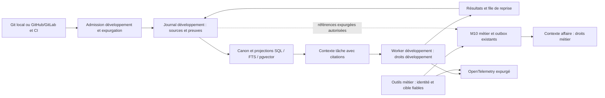

# M10 et mémoire de développement — recherche et architecture proposée

Recherche en lecture seule, observée le **30 septembre 2026**. Cible : `/workspace/OPSYS-AI-recent`, commit **2e56c0d5605dfe575bde9244f38924d5390f2674**. Aucun service installé, aucun code du dépôt modifié, aucun résultat de banc fournisseur présenté comme résultat OPSYS. Les preuves externes comprennent six recherches Exa, les pages officielles pertinentes, et les fichiers de licence/README de **23 dépôts**, lus à des commits précis. Le registre [depots-licences-commits.json](preuves-m10/depots-licences-commits.json) contient les SHA complets, dates, URLs et empreintes des fichiers ; [complements-sources.json](preuves-m10/complements-sources.json) conserve les exceptions de licence et les adaptateurs de checkpoints.

**Choix recommandé : conserver la fondation M10, réparer ses frontières, puis ajouter une mémoire de développement séparée sur les stockages déjà présents.** Git, les PR/MR, les décisions versionnées et les résultats CI fournissent les preuves primaires. PostgreSQL fournit journal, canon, relations, temporalité et recherche hybride ; SQLite reste adapté au poste local et à une file de reprise. Un framework de mémoire supplémentaire ne devient utile qu'après un banc montrant un manque réel. Le besoin de Nathan dépasse le RAG : celui-ci n'est que la fonction de recherche dans ce système.

La directive actuelle réintroduit la mémoire de développement, contrairement à l'exclusion antérieure de la mémoire usine. Elle ne réintroduit aucune dépendance à Forge pour installer ou exécuter le produit. Le développement et le métier restent deux domaines distincts pour les droits, les données, les rétentions et les credentials ; ils peuvent partager des identifiants de contrat et des références expurgées. Le consensus entre plusieurs modèles n'est pas une condition de livraison du développement. Les identités, permissions et décisions humaines métier demeurent obligatoires.

## 1. Ce qui existe réellement et mérite d'être conservé

M10 possède deux registres Événements/Affaires hash-chaînés, des décisions motivées, des revisions sans fusion silencieuse, des références vérifiables, une préparation du contexte, des paquets de quatre couches, une consolidation déterministe par affaire/jour, des candidats après exécution et un cycle de traitement des signaux. Voir [registre.py](../../../departments/m10-memoire/src/m10_memoire/registre.py#L39), [paquets.py](../../../departments/m10-memoire/src/m10_memoire/paquets.py#L273), [faits_candidats.py](../../../departments/m10-memoire/src/m10_memoire/faits_candidats.py#L106) et [outils.py](../../../departments/m10-memoire/src/m10_memoire/outils.py#L442). Les candidats sont une trace de résultats d'outils, pas la vérité canonique ni un résumé libre de ce que le modèle affirme.

Le branchement au vrai core existe : [opsys-contexte-engine.ts](../../../core/src/context-engine/opsys-contexte-engine.ts#L319) assemble le paquet avant le tour, vérifie son enveloppe et ses budgets, puis dépose des résultats après le tour. Le paquet trop grand est refusé, sans troncature réparatrice du core. Le runtime conserve sa compaction. Les mentions « GATED » à la fin du README M10 et les références OpenClaw amont de `RAG-PREMIUM.md` ne suffisent donc pas à décrire le raccordement livré : le code du fork et l'audit récent priment.

La couche `src/opsys/memoire` fournit déjà documents/sources, fragments, métadonnées de portée et sensibilité, sujets, échéance, embeddings 1024 dimensions, FTS français désaccentué, HNSW et fusion RRF. Voir [schema.sql](../../../src/opsys/memoire/schema.sql#L26) et [store.py](../../../src/opsys/memoire/store.py#L264). L'effacement est journalisé et la rétention personnelle a des contraintes utiles. Le socle SQLite a démontré l'atomicité métier/outbox/audit/idempotence, la sauvegarde WAL cohérente et l'inclusion des blobs dans la base, dans les limites des probes de l'audit [DON](audit/donnees.md).

Le core possède aussi provenance des fichiers de mémoire, transcriptions, dreaming et un journal des opérations de rappel/promotion. [event-store.ts](../../../core/src/memory-host-sdk/event-store.ts#L10) borne ce dernier à 10 000 événements et tronque certaines données ; [memory-artifact-provenance.ts](../../../core/src/memory/memory-artifact-provenance.ts#L10) suit l'origine et l'empreinte des fichiers. Ce journal de diagnostic ne constitue pas à lui seul un historique de développement exhaustif. Cette recherche ne certifie pas toutes les portes de promotion de la mémoire native ; il faut les vérifier sur le fork épinglé avant de lui confier du canon.

Les limites actuelles sont concrètes : aucune chaîne intégrée prompt → plan → commit → CI → décision pour le développement ; aucun graphe d'entités/relations gouverné de ce domaine ; consolidation journalière insuffisante face aux événements tardifs ; dépôt après tour susceptible d'être perdu en cas d'échec MCP, avec journal d'avertissement plutôt qu'une file durable de rattrapage ([engine.ts](../../../core/src/context-engine/opsys-contexte-engine.ts#L485)). L'audit de non-oubli est honnêtement borné aux identifiants **fournis par l'appelant**, pas à tous les faits possibles ([audit.py](../../../departments/m10-memoire/src/m10_memoire/audit.py#L59)).

## 2. Invariants de l'audit à fermer avant l'enrichissement

Ces constats viennent de la cible récente, pas de l'ancien audit : [CONSTATS-RECENTS.json](audit/CONSTATS-RECENTS.json), [rapport départemental](audit/departements.md), [rapport core/docs](audit/core.md) et [rapport données](audit/donnees.md). Ils imposent les contrats suivants ; installer un meilleur retriever ne les résout pas.

| Constat et preuve | Contrat architectural à imposer |
|---|---|
| **DON-05, P2** : un département connaissant l'ID d'un artefact peut le lire par l'outil commun ; stockage sans scope. Reproduction au répartiteur ; appareils fermés sur ce chemin. | Toute lecture d'artefact dérive tenant, domaine, département et acteur de la session fiable. Stocker droits et rétention avec l'objet ; contrôler aussi les citations, blobs, exports, caches et checkpoints. Un hash/ID connu n'est pas une permission. |
| **DON-06, P2** : même source/texte ajouté par un autre département autorisé remplace portée, sensibilité, sujets et échéance. Reproduction PostgreSQL avec ajout T1 approuvé en ombre ; pas de transfert externe prouvé. | Déduplication dans le périmètre de gouvernance ; collision hors périmètre refusée ou nouvelle version distincte. Aucun upsert de contenu ne déclassifie implicitement un fait ni n'efface sa rétention. Reclassification explicite et auditée par une autorité habilitée. |
| **DEP-002, P1** : `agent` fourni librement à l'outil M10 ouvre la vue CLIENT_PRIVATE d'un autre destinataire. Reproduction publique T0 sans approbation d'écriture. | Le destinataire est dérivé de l'identité authentifiée au point de lecture. Tout paramètre client éventuel ne peut que restreindre la vue. Le filtre pur ne remplace pas ce contrôle au répartiteur. |
| **C01, P1 conditionnel** : un shell agent partageant les droits de l'instance retire le marqueur d'environnement et affirme une identité humaine via `--par`. Preuve statique, scénario complet non rejoué. | Séparation effective des comptes/processus/credentials agent et opérateur ; authentification ou capacité humaine vérifiée au point de mutation. Aucun fournisseur de mémoire ni variable d'environnement ne remplace cette frontière. |
| **C02, P1** : contexte prêt de A autorise un outil visant B, faute de cible dans la garde ; le dépôt peut ensuite être attribué à A. Preuve de branches/raccordements, effet métier complet non rejoué. | Extraire la cible des arguments finaux selon le contrat d'outil, comparer domaine/affaire/version au contexte, refuser cible absente/ambiguë pour les actions gardées ; conserver ce même rattachement après exécution. |
| **C03, P2** : moteur activé mais configuration invalide ouvre la garde N3+. Choix explicitement documenté et testé. | Distinguer arrêt volontaire et activation invalide ; cette dernière bloque les actions concernées. Ne pas déduire « prêt » d'un service démarré ou d'une mémoire vide. |
| **DEP-006, P2** : après consolidation d'un jour, une nouvelle source du même jour reste hors résumé ; 2 événements, 1 source. Les événements bruts subsistent. | Versions de consolidation par empreinte de l'ensemble des sources/position de lecture ; rouvrir les partitions impactées par les arrivées tardives et vérifier la couverture des sources. |
| **Dépôts orphelins/non effectués** : la branche postflight sans affaire identifiable ou en échec laisse des faits non déposés. | File durable avec état, clé d'opération, cible réelle, causes de refus et compteur de tentatives ; réconciliation indépendante entre exécutions terminées, outbox, sources et dérivés. Ne jamais forcer un rattachement inventé. |

L'architecture minimale conserve les contrôles positifs, les rôles relus au départ des actions sensibles et les actions T3 humaines. L'automatisation d'une réindexation, d'un résumé ou d'un plan de développement n'autorise pas un paiement, une approbation nominative, une publication publique ou un changement de droits métier.

## 3. Exigences Nathan → existant → manque → adaptation minimale

Dans cette table, « présent » désigne du code inspecté, pas une garantie opérationnelle complète. Les ajouts sont des propositions ; ils ne sont pas implémentés ici.

| Exigence | Capacité existante / preuve | Manque | Brique ou adaptation proposée |
|---|---|---|---|
| Event log des prompts, plans, décisions, code, tests et erreurs | Registres M10, outbox/audit SQLite, transcriptions du core ; journal mémoire natif borné. | Un contrat de capture unique et complet du développement, source primaire, outcome et corrélation. | Git/PR/MR/CI d'abord ; événements de développement typés à clés stables dans une base séparée, avec liens vers contenu à empreinte et commit précis. Capture sélective et expurgée, pas copie de toutes les conversations métier. |
| Canon, hypothèses et décisions sans confusion | Décisions motivées, revisions et candidats distincts dans M10. | Admission et statut du canon développement ; lien vers preuve et remplacement explicite. | États observation/candidat/validé/rejeté/obsolète ; le résultat CI exact peut devenir preuve via un validateur, le résumé LLM reste dérivé. Toute nouvelle connaissance canonique cite sa source. |
| Entités et relations / graphe | Affaire, ligne source et références ; metadata JSON du RAG. | Entités développements/projets/exigences/symboles/commits/tests ; relations typées et parcours. | Tables `entities`/`relations` et index SQL, contraintes de domaine et références ; CTE récursives bornées. Tree-sitter pour extraire symboles/relations syntaxiques ; hypothèses sémantiques proposées séparément. |
| Temporalité et contradictions | Horodatages sources, décisions/revisions ; consolidation par jour. | Temps de validité vs temps d'observation, arrivée tardive, version du code, invalidation sans effacement. | Champs `valid_from/valid_to`, `recorded_at`, version/commit et relation `supersedes` ; canonicaliser les instants sans perdre l'horodatage source. Interdire fusion silencieuse de contenus divergents sous même clé. |
| Préflight pertinent avant modification | Paquet 4 couches et garde core. | Cible finale liée au contexte et couverture des exigences développement. | Contexte projet → dépôt/branche → tâche → fichiers/symboles, permissions d'abord ; C02/C03 fermés. Montrer fraîcheur, contradictions et sources manquantes ; réserver dans le budget le canon et les blocages, puis élargir par recherche. |
| Postflight : ce qui a changé et ce qui a été testé | Dépôt de résultats d'outils en `candidat`. | Prompts/plans, diff/commit, environnement CI et erreurs sourcées ; crash/rattrapage. | Contrat `operation_id`, cible, inputs/outputs expurgés, commit, commande, exit code, artefact, statut ; écrire l'intention/fin via file durable, rattraper les runs orphelins. Aucun récit du modèle n'atteste un test. |
| Contexte hiérarchique et budgets | Quatre couches, budgets, omissions comptées, core refuse paquet excessif. | Hiérarchie développement, sélection de sources non perdue, reprise du détail. | Références stables même quand résumé/texte sont omis ; recherche détaillée autorisée par scope. SQL/FTS puis pgvector/RRF ; QMD uniquement comme aide locale optionnelle pour docs, avec collections autorisées. |
| Consolidation reprenable | Consolidation déterministe affair/jour idempotente. | Positions, ensemble des sources versionné, crash-safe, tardifs, qualité des résumés. | Jobs SQL avec lease, état/cursor, clés source + version transformateur, reprise par lots et DLQ ; dérivés reconstruisibles. LangGraph checkpoints seulement si son orchestration remplace un besoin de workflow réel, jamais comme canon. |
| Rappel sourcé / évals | Jeu fictif de tests RAG et audit d'identifiants attendus. | Éval inter-session et multi-hop, oubli voulu, mauvaise affaire, contradiction, latence/coût mesurés. | Jeux d'or indépendants des consommateurs ; citations évaluées automatiquement et trace de sources. Pytest/CI existants d'abord ; choisir au plus un adaptateur Ragas, DeepEval ou Promptfoo selon le banc. |
| Self-model | Capacités et manifestes des départements, états/modes/paliers ; provenance native. | Modèle explicite des capacités de développement et de leurs limites/fraîcheur. | Vue déterministe de manifestes/outils/versions/permissions et historique de résultats ; statistiques empiriques par tâche. Les auto-descriptions du LLM sont des hypothèses, jamais une autorité de permission. |
| Développement séparé métier/PII | Filtrage et rétention RAG, niveaux M10 ; frontières imparfaites prouvées. | Domaines/credentials explicites et croisements contrôlés. | Base ou credentials SQL séparés, absence d'outil métier dans le worker développement, copies expurgées à admission explicite. Réparer DON-05/06 et DEP-002 avant partage. Pas de simple `tag=dev` dans un magasin accessible à tous. |
| Rétention, effacement et provenance | Expiration/sujets/journal de purge RAG ; primitives natives distinctes. | Cascade de dérivés, sauvegardes, artifacts CI, transcripts, traces et graphes ; prévention de réingestion. | Inventaire de supports, lineage source→dérivé, tombstones et politique propre à chaque classe. L'event log conserve au besoin une preuve minimale non personnelle et un marqueur d'effacement, pas obligatoirement le texte brut pour toujours. |

## 4. Minimum cohérent à viser

**Capture et preuves.** Réutiliser l'installation GitHub ou GitLab déjà choisie : issue/tâche pour l'intention, plan/ADR versionné pour la décision, commit et diff pour le code, pipeline/job pour les commandes et résultats. Les discussions PR/MR restent modifiables ; enregistrer au moment de l'admission version, URL/ID, timestamp et empreinte du snapshot admis. Les logs/actions échouées valent aussi preuves. Les artefacts GitHub ont une rétention configurable et les artefacts GitLab une expiration ; une URL sans rétention vérifiée ne suffit pas. Exporter seulement les preuves nécessaires dans le stockage gouverné avant expiration. Les attestations CI peuvent renforcer la provenance d'un build, pas prouver que tous les tests utiles ont été exécutés.

L'installation OPSYS ne dépend pas de ces services : le journal local fonctionne hors ligne, avec références Git locales, puis un adaptateur importe les éléments disponibles. Aucun clone de Forge, deuxième gestionnaire de projet ou copie du code GitHub/GitLab n'est nécessaire. L'utilisation de leurs APIs suit les permissions et contrats du service ; les bibliothèques/actions effectivement reprises devront être épinglées et licenciées dans INGREDIENTS au moment d'une adoption.

**Stockage et modèle.** Garder le stockage métier SQLite/outbox là où les transactions locales existent. Pour le développement, utiliser une base PostgreSQL dédiée sur l'instance déjà prévue, avec credentials distincts ; un schéma seul n'est une frontière que si GRANT/RLS et les comptes OS empêchent le contournement. Le rôle applicatif ne doit être ni propriétaire, ni superuser, ni `BYPASSRLS` ; RLS n'est pas activé par défaut et le propriétaire peut le contourner. Pour un poste sans PostgreSQL, SQLite + FTS5 fournit un journal/FTS local, à synchronisation explicitement gouvernée. Il ne faut pas faire passer deux écritures SQLite/PostgreSQL pour une transaction distribuée atomique : outbox + ingestion idempotente + réconciliation.

Le modèle conceptuel minimal contient `events`, `artifacts`, `canonical_items`, `entities`, `relations`, `derivations`, `jobs` et `retention_actions`. Chaque enregistrement porte domaine/tenant, auteur authentifié, source, classification, politique de rétention, identité/version et références de preuve. Un événement distingue type métier/calculé/hypothèse, temps de validité et temps observé. Une relation contient ses extrémités, type, domaine, source et validité ; les relations tirées d'un résumé ne deviennent pas des faits vérifiés par défaut. La clé d'idempotence inclut périmètre + origine + opération + version ; même clé avec contenu changé donne un conflit explicite. Ces noms décrivent des contrats, pas une migration livrée.

**Recherche et contexte.** Autoriser la portée avant la recherche et avant la lecture du texte/citation. Parcours relationnel exact et FTS pour références/symboles/noms ; recherche vectorielle pour paraphrases ; fusion RRF déjà présente. Les résultats incluent provenance, statut, validité et motifs de manque. Le contexte injecté sépare instructions fiables et données rappelées ; aucun contenu de document, de discussion ou de log de test ne peut modifier les instructions système ou autoriser un outil. Le même source-ID doit rester résolvable dans le domaine autorisé après compaction. Un résumé ne remplace ni le source-ID ni les preuves.

**Reprise.** Le captureur écrit un travail durable puis progresse par lots vers des dérivés reconstruisibles. Les traitements portent version du parser/modèle/template, paramètres, checkpoint et empreintes sources. Rejouer un lot ne rejoue pas un effet métier : les effets passent par l'idempotence du vrai outil. Les jobs de consolidation rattrapent les nouvelles sources d'une ancienne période, et la réconciliation compare un ensemble attendu indépendant aux événements reçus et aux dérivés. Les écritures après crash, refus de contexte et données sans cible restent visibles dans une file, jamais silencieusement ignorées.

**Observabilité.** Réutiliser OpenTelemetry pour `trace_id`, `run_id`, latence, consommation, erreurs et références d'opération, en évitant par défaut prompts complets et données personnelles. Les conventions GenAI sont actuellement en statut **Development** et le contenu est sensible/opt-in : épingler une version, désactiver la capture de payload métier et vérifier les collecteurs/exporteurs réellement actifs. Une trace sert à retrouver une preuve ; le canon gouverné ne dépend pas de sa conservation. Langfuse reste optionnel si une interface de revue justifie son propre stockage et sa politique d'accès/rétention.

Le lien entre les domaines porte par exemple « exigence de validation WCT → commit → test → décision », avec identifiants techniques et fixture fictive. Il ne transporte pas par défaut noms, conversations client, GPS, captures, factures nominatives ou credentials. La suppression du consensus modèles concerne le développement : CI, invariants déterministes et preuves sont l'autorité de qualité ; une appréciation LLM peut aider à la revue, sans vote d'admission canonique ni signature humaine fabriquée.

## 5. Briques examinées et choix

Les licences ci-dessous sont celles des fichiers réellement lus au commit indiqué. Ce contrôle ne certifie pas les dépendances transitives, les plugins, modèles/poids, images ou contrats cloud. Toute adoption exige leur examen, un pin de version et une entrée INGREDIENTS ; il ne s'agit pas d'une autorisation de déploiement.

| Brique | Licence vérifiée / actualité | Apport adapté au besoin | Limite importante et choix |
|---|---|---|---|
| **PostgreSQL + pgvector + FTS ; SQLite FTS5** | Licence PostgreSQL permissive pour PG/pgvector ; SQLite bibliothèque/FTS dans le domaine public, certains outils de build à licence distincte. Sources au 30/09. | SQL fiable, provenance, temporalité, règles d'intégrité, relations + CTE récursives, lexical/vectoriel. | Aucun de ces moteurs ne fournit automatiquement admission/canon/RBAC. **Socle recommandé**, déjà présent ; parcours bornés et index mesurés avant autre graphe. |
| **LlamaIndex** | MIT ; commit du 29/09. | Parsers/connecteurs, gestion des documents, PropertyGraphIndex et retrievers hybrides ; extraction et lien vers source. | Framework d'ingestion/recherche, pas un journal de vérité ni une sécurité métier. **Adaptateurs ciblés possibles**, pas second magasin ni agent TextToCypher autonome d'écriture. Les stores/connecteurs ont leurs propres dépendances. |
| **LangGraph checkpoints** | MIT, confirmé root + packages checkpoint/Postgres/SQLite ; commit du 27/09. | État de thread, reprise, interruptions, inspection/time travel ; SQLite local, PostgreSQL durable. | Checkpointer ≠ mémoire long terme : Store est distinct. Replay peut réexécuter appels/outils après le checkpoint ; idempotence et rétention nécessaires. **Seulement si besoin d'orchestration non couvert** ; pas ajouter pour la seule mémoire. |
| **Cognee** | Apache-2.0 ; commit du 29/09. | Pipelines documents→entités/relations, retrieval de graphes et provenance. | Doc officielle : graph PG open source **demo, non prêt production**, adaptateur production licencié ; backend local Kuzu/Ladybug avec verrous, concurrent multi-processus à considérer. **Banc possible, différé du minimum** : autre graph service ou composant commercial. |
| **Graphiti** | Apache-2.0 ; commit du 30/09. | Graphes temporels, faits bi-temporels, épisodes, invalidation préservant l'histoire, recherche hybride. | Backends listés Neo4j/FalkorDB/Neptune(+OpenSearch), Kuzu déprécié ; pas d'adaptateur PostgreSQL natif listé. Extraction LLM et déduplication à évaluer, pas vérité garantie. **Option phase ultérieure** si graphe temporel requis au-delà de SQL. |
| **Zep** | Repo Apache-2.0 ; commit du 11/09. | Intégrations/exemples du service Zep Cloud ; Graphiti est le moteur OSS associé. | Le repo actuel n'est plus le serveur Zep auto-hébergeable ; Community dans `legacy/`, dépréciée et non supportée. **Écarter comme nouveau service OSS local** ; les conditions cloud sont distinctes de la licence du repo. |
| **mem0** | Apache-2.0 ; commit du 25/09. | Extraction de mémoires conversationnelles, history, outils user/agent/run ; serveur peut employer PG/pgvector. | Défauts documentés de la bibliothèque : OpenAI LLM/embedding + Qdrant local et SQLite history ; classification/canon métier OPSYS non fournis. **Pas retenu pour le socle**, usage très borné de préférences seulement après gouvernance et backend local explicites. |
| **OpenTelemetry Python + conventions GenAI** | Apache-2.0, deux licences lues ; SDK commit du 29/09, conventions commit indiqué en annexe. | Standard interopérable des traces et corrélations ; sépare mesure du moteur de mémoire. | Conventions GenAI encore Development ; payloads potentiellement sensibles, capture à contrôler. **Option d'instrumentation minimale**, sans imposer un nouveau service collecteur. |
| **Langfuse** | MIT hors `ee/`, `web/src/ee/`, `worker/src/ee/` et composants tiers ; **Enterprise License** pour ces exceptions, lue. Commit du 30/09. | UI de traces, prompts, datasets/évaluations et revue. | Compose actuel ajoute notamment ClickHouse, PG, stockage objet et cache ; droits/rétention propres. **Différer jusqu'à besoin d'UI**. Ne pas annoncer « tout MIT » ni adopter des fonctions EE sous licence libre. |
| **Ragas** | Apache-2.0 ; dernier commit de la branche observée du 24/02. | Métriques RAG, évaluations traditionnelles/LLM et génération de datasets. | Un score de fidélité LLM ne prouve pas la complétude d'un journal ni l'autorisation. **Un adaptateur possible** au banc, version et dépendances à vérifier. |
| **DeepEval** | Apache-2.0 ; commit du 29/09. | Tests façon pytest, métriques retrieval/conversation, outils/arguments/plans. | Métriques locales ou dépendant du modèle choisi ; option cloud distincte. **Alternative à Ragas**, pas ajout simultané automatique. Les assertions déterministes restent séparées. |
| **Promptfoo** | MIT ; commit du 30/09. | CLI de matrices prompts/modèles, assertions/éval et cas adversariaux. | Pertinent pour prompts/entrées ; ne gère pas canon, jobs ou vérité des résultats métier. **Alternative** si matrice multi-config utile ; aucun consensus de modèles exigé. |
| **Hindsight** | MIT ; commit du 30/09. | PG, retain/recall/reflect ; recherche sémantique/BM25/graphe/temporelle ; observations sourcées, mental models ; intégration d'agents de code avec banque par repo, historique Git/sessions et pages curées. | Intégration actuelle : ingestion automatique Git/conversations et `autoUpdate` actif par défaut. Adapter capture sélective, version épinglée et identité du repo ; extraction/reconciliation restent dérivées. RBAC, injection et effacement à prouver. **Pépite prioritaire pour un banc isolé développement**, sans canon autonome ni scores vendeur repris comme preuves. |
| **LightRAG** | MIT ; commit du 26/09. | Index entités/relations, mises à jour/invalidation de documents ; PG pour les quatre stores. | Graphe PG repose sur **Apache AGE**, pas uniquement PG+pgvector. Source actuelle refuse AGE ≥1.8 sans override de risque ; changement d'embedding exige reconstruction et pas d'outil de ré-embedding documenté. **Banc différé**, utile seulement si gain graphe prouvé. |
| **Letta** | Apache-2.0 ; commit du 10/09. | Agent à blocs de mémoire, stockage historique et état. | Remplace aussi une orchestration/agent runtime déjà présent. **Leçon de conception**, pas troisième moteur agent. |
| **QMD** | MIT ; commit du 09/09. | Recherche docs locale BM25/vecteurs/rerank GGUF, collections et contexte hiérarchique, CLI/MCP. | Ni canon, event log exhaustif, ni droits métier intrinsèques ; modèles locaux et dépendances à vérifier. **Option légère poste développement** si besoin docs démontré ; chemins autorisés seulement. |
| **Tree-sitter / Zoekt** | MIT / Apache-2.0 ; commits du 30/09 / 11/09. | Symboles structurés / recherche exacte code à grande échelle, traçable par commit/path. | Les relations syntaxiques ne prouvent pas toutes les dépendances sémantiques ; index périssables. **Tree-sitter ciblé envisageable**, Zoekt uniquement si la recherche Git/rg ne suffit plus. |
| **zvec / sqlite-vec** | Apache-2.0 / choix MIT ou Apache-2.0, deux fichiers lus ; commits du 29/09 / 18/05. | Recherche vectorielle embarquée, utile au poste sans serveur. | N'apportent pas canon/temporalité/gouvernance ; doublonnent pgvector sur serveur. **Écarter du minimum**, réévaluer pour un profil entièrement local. |

Ces outils n'ont pas tous la même maturité fonctionnelle. Commit récent et popularité indiquent activité, pas compatibilité ni fiabilité pour OPSYS. Aucun moteur de graphes, de mémoire ni d'évaluation n'a été exécuté pendant cette recherche ; compatibilité, charge et qualité sur le corpus OPSYS sont **BLOCKED jusqu'au banc isolé**.

## 6. Validation requise et limites mesurables

La première phase est un lot de contrats et de preuves, pas un choix de framework : droits et ciblage (DON-05/06, DEP-002, C01/02/03), source/version, conflits explicites, arrivée tardive, outbox et rattrapage. Elle doit précéder une consolidation LLM ou un graphe d'extraction. Les contrôles de régression passent par les vrais points d'entrée et credentials, pas seulement par les fonctions pures.

Le jeu d'or développement doit relier des questions aux sources/versions attendues : raison d'une décision ancienne, plan remplacé, test qui prouve un correctif, erreur résolue puis réintroduite, symbole renommé, conflit de branches, source supprimée, fait tardif et dérivé expiré. Ajouter des cas métier fictifs leads/soumissions/WCT/factures qui prouvent l'absence de passage PII vers le développement. Constituer les attendus depuis les événements autoritatifs ou fixtures indépendants, jamais depuis la liste des consommateurs présents ou les seuls résultats déjà indexés.

| Mesure/contrat | Preuve nécessaire avant de déclarer prêt |
|---|---|
| Capture et couverture | Dénominateur indépendant des opérations attendues ; pour chaque source, statut reçu/refusé/expiré/orphelin et cause. Liste vide d'attendus = aucune couverture vérifiée. |
| Rappel et citations | Recall@k/MRR/nDCG suivant le jeu défini ; sources citées présentes, autorisées et à la bonne version. Distinguer récupération du bon fragment et réponse justifiée. Les cibles .85 Recall@5/.70 MRR du RAG existant restent des cibles, pas résultats de cette recherche. |
| Exactitude/canon | Aucun chiffre métier calculé par LLM ; faits validés issus d'outils/preuves, hypothèses visibles, contradictions non masquées. Un classement ou juge LLM aide la qualité, sans preuve d'identité ni d'autorisation. |
| Reprise et tardifs | Arrêt injecté avant/après commit/checkpoint, succès externe suivi de timeout, reprise du même lot, arrivée tardive sur période close ; pas double effet, pas preuve perdue et couverture recalculée. |
| Cloisonnement | Même source/hash dans deux domaines ; ID connu hors scope ; faux destinataire ; acteur révoqué ; cible B après lecture A ; SQL sous rôle applicatif ; refus avant lecture ou effet. |
| Rétention/effacement | Suppression ciblée sources/dérivés/embeddings/caches/traces/checkpoints, réingestion interdite, preuve de ce qui reste dans sauvegardes/forges. Expiration ne doit pas transformer une ancienne citation en preuve actuelle. |
| Coût/latence | Corpus et environnement décrits, volumes, p50/p95, tokens, coût consolidation, sources omises ; comparer FTS seul, hybride existant et au plus un candidat sur le même jeu. Aucun seuil universel inventé. |
| Self-model | Capacité annoncée = outil/version/droit effectivement disponible ; incident récent modifie le statut disponible/limité, jamais les permissions du modèle. |

Ensuite seulement, comparer **minimum SQL** à **un candidat** : Hindsight pour épisodes/temporalité, ou Graphiti pour parcours temporels multi-hop devenus nécessaires. LlamaIndex est une bibliothèque d'adaptation possible au sein du minimum ; QMD est un outil local optionnel ; LangGraph est un choix d'orchestration ; Langfuse un choix de revue. Les sélectionner tous simultanément créerait plusieurs sources, politiques de rétention et mécanismes de consolidation concurrents sans preuve du bénéfice.

**Aucune promesse de non-oubli à 100 %.** Un journal durable ne garantit ni que toute source a été capturée, ni que le retrieval la trouvera, ni que le modèle la comprendra. L'effacement voulu, l'expiration, les droits, les quotas, les sources externes indisponibles et les budgets de contexte réduisent légitimement ce qui est rappelable. Le contrat utile est : couverture mesurée sur un périmètre déclaré, lacunes visibles, provenance résolvable tant que la politique le permet, reconstruction des dérivés et refus d'action quand les preuves critiques manquent. Une chaîne de hash détecte certaines altérations par rapport à une ancre conservée ; elle ne rend pas un magasin partagé avec un acteur privilégié matériellement inaltérable.

## 7. Sources primaires et statut des preuves

- **PROUVÉ par lecture du code et probes existantes** : capacités M10/RAG ci-dessus et défauts de frontières cités, avec les préconditions et niveaux de preuve de l'audit récent. Cette recherche n'étend pas les reproductions statiques C01/02/03 à une exploitation générale.
- **PROUVÉ par récupération primaire publique** : commits, README et licences archivés, y compris exceptions Langfuse EE, dualité sqlite-vec, packages checkpoints et conventions GenAI. Les artefacts JSON conservent dates, URLs et hashes ; une licence inconnue de l'API GitHub (`NOASSERTION`) a été résolue par lecture du texte et n'est pas assimilée à une interdiction.
- **DOCUMENTÉ par l'éditeur, non mesuré ici** : capacités, limites et configurations par défaut des candidats. Les pages sont officielles mais présentent naturellement leur produit ; les gains commerciaux et benchmarks ne justifient pas une adoption.
- **BLOCKED jusqu'à vérification ciblée** : benchmark OPSYS, modèles/poids et dépendances transitives, complète politique d'effacement multi-supports, adaptateur commercial Cognee, droits/service cloud Zep, fonctionnalités Langfuse EE et compatibilité AGE. Ce sont des limites d'adoption ; elles n'empêchent pas le minimum fondé sur le socle existant.

Pages officielles complémentaires, capturées dans les JSON Exa : [graph stores Cognee](https://docs.cognee.ai/setup-configuration/graph-stores), [persistence LangGraph](https://docs.langchain.com/oss/python/langgraph/persistence), [durable execution LangGraph](https://docs.langchain.com/oss/python/langgraph/durable-execution), [mem0 OSS](https://docs.mem0.ai/open-source/overview), [LlamaIndex document management](https://developers.llamaindex.ai/python/framework/module_guides/indexing/document_management/), [Hindsight observations](https://hindsight.vectorize.io/developer/observations), [Hindsight coding agents](https://hindsight.vectorize.io/sdks/integrations/coding-agents), [PostgreSQL CTE récursives](https://www.postgresql.org/docs/17/queries-with.html), [PostgreSQL RLS](https://www.postgresql.org/docs/17/ddl-rowsecurity.html), [SQLite FTS5](https://www.sqlite.org/fts5.html), [SQLite récursivité](https://www.sqlite.org/lang_with.html), [GitHub artefacts/retention](https://docs.github.com/en/actions/tutorials/store-and-share-data), [GitHub attestations](https://docs.github.com/en/actions/security-guides/using-artifact-attestations-to-establish-provenance-for-builds), [GitLab job artifacts](https://docs.gitlab.com/ci/jobs/job_artifacts/), [GitLab MR](https://docs.gitlab.com/user/project/merge_requests/).

## Annexe — pins et licences primaires

Pins observés de recherche, pas versions sélectionnées pour déploiement. Les sources mutable de documentation sont datées dans les preuves ; le code et les licences ci-dessous sont accessibles au SHA. Voir aussi [synthese-preuves.json](preuves-m10/synthese-preuves.json).

| Dépôt | Commit observé (UTC) | Licence primaire |
|---|---|---|
| [topoteretes/cognee](https://github.com/topoteretes/cognee) | [ba3631f2ed36](https://github.com/topoteretes/cognee/commit/ba3631f2ed363a6ea50d649c34c56885af6b36fe) — 2026-09-29 | Apache-2.0 ; [LICENSE](https://github.com/topoteretes/cognee/blob/ba3631f2ed363a6ea50d649c34c56885af6b36fe/LICENSE) |
| [run-llama/llama_index](https://github.com/run-llama/llama_index) | [7e2c60a78ec2](https://github.com/run-llama/llama_index/commit/7e2c60a78ec27e8d146dfdd596778aea83c041d5) — 2026-09-29 | MIT ; [LICENSE](https://github.com/run-llama/llama_index/blob/7e2c60a78ec27e8d146dfdd596778aea83c041d5/LICENSE) |
| [langchain-ai/langgraph](https://github.com/langchain-ai/langgraph) | [07b33185eab8](https://github.com/langchain-ai/langgraph/commit/07b33185eab893be2ed031eedae52f09314bf77c) — 2026-09-27 | MIT ; [LICENSE](https://github.com/langchain-ai/langgraph/blob/07b33185eab893be2ed031eedae52f09314bf77c/LICENSE), [libs/checkpoint/LICENSE](https://github.com/langchain-ai/langgraph/blob/07b33185eab893be2ed031eedae52f09314bf77c/libs/checkpoint/LICENSE), [libs/checkpoint-postgres/LICENSE](https://github.com/langchain-ai/langgraph/blob/07b33185eab893be2ed031eedae52f09314bf77c/libs/checkpoint-postgres/LICENSE), [libs/checkpoint-sqlite/LICENSE](https://github.com/langchain-ai/langgraph/blob/07b33185eab893be2ed031eedae52f09314bf77c/libs/checkpoint-sqlite/LICENSE) |
| [getzep/graphiti](https://github.com/getzep/graphiti) | [3c427640abf9](https://github.com/getzep/graphiti/commit/3c427640abf909f12f71f963fce15eb514a3c493) — 2026-09-30 | Apache-2.0 ; [LICENSE](https://github.com/getzep/graphiti/blob/3c427640abf909f12f71f963fce15eb514a3c493/LICENSE) |
| [getzep/zep](https://github.com/getzep/zep) | [495bf72880d1](https://github.com/getzep/zep/commit/495bf72880d13f0b81696ec4f88a9817ed85ca73) — 2026-09-11 | Apache-2.0 ; [LICENSE](https://github.com/getzep/zep/blob/495bf72880d13f0b81696ec4f88a9817ed85ca73/LICENSE) |
| [mem0ai/mem0](https://github.com/mem0ai/mem0) | [94c3fe9f238f](https://github.com/mem0ai/mem0/commit/94c3fe9f238f3dbf29c9ce98643bd71eb13077cd) — 2026-09-25 | Apache-2.0 ; [LICENSE](https://github.com/mem0ai/mem0/blob/94c3fe9f238f3dbf29c9ce98643bd71eb13077cd/LICENSE) |
| [open-telemetry/opentelemetry-python](https://github.com/open-telemetry/opentelemetry-python) | [cee5f52e2d00](https://github.com/open-telemetry/opentelemetry-python/commit/cee5f52e2d009085a330874ea8d1549eb5b68baa) — 2026-09-29 | Apache-2.0 ; [LICENSE](https://github.com/open-telemetry/opentelemetry-python/blob/cee5f52e2d009085a330874ea8d1549eb5b68baa/LICENSE) |
| [langfuse/langfuse](https://github.com/langfuse/langfuse) | [0de9ccd64e0f](https://github.com/langfuse/langfuse/commit/0de9ccd64e0f9d35c1990fb6c851fa00530e7960) — 2026-09-30 | MIT sauf ee/, web/src/ee/, worker/src/ee/ Enterprise License et tiers ; [LICENSE](https://github.com/langfuse/langfuse/blob/0de9ccd64e0f9d35c1990fb6c851fa00530e7960/LICENSE), [ee/LICENSE](https://github.com/langfuse/langfuse/blob/0de9ccd64e0f9d35c1990fb6c851fa00530e7960/ee/LICENSE) |
| [explodinggradients/ragas](https://github.com/explodinggradients/ragas) | [298b68274234](https://github.com/explodinggradients/ragas/commit/298b68274234c060deacab3cf5fb52aa3a20e885) — 2026-02-24 | Apache-2.0 ; [LICENSE](https://github.com/explodinggradients/ragas/blob/298b68274234c060deacab3cf5fb52aa3a20e885/LICENSE) |
| [confident-ai/deepeval](https://github.com/confident-ai/deepeval) | [b13093cf9c9b](https://github.com/confident-ai/deepeval/commit/b13093cf9c9b5468dbe7d00529e8f20e14300d55) — 2026-09-29 | Apache-2.0 ; [LICENSE.md](https://github.com/confident-ai/deepeval/blob/b13093cf9c9b5468dbe7d00529e8f20e14300d55/LICENSE.md) |
| [promptfoo/promptfoo](https://github.com/promptfoo/promptfoo) | [e6b46046e7f4](https://github.com/promptfoo/promptfoo/commit/e6b46046e7f454edc54b27143cb0902d929f3fa6) — 2026-09-30 | MIT ; [LICENSE](https://github.com/promptfoo/promptfoo/blob/e6b46046e7f454edc54b27143cb0902d929f3fa6/LICENSE) |
| [pgvector/pgvector](https://github.com/pgvector/pgvector) | [70fb225dc0b9](https://github.com/pgvector/pgvector/commit/70fb225dc0b9a6abb9aa05508a1f770dd1b05a23) — 2026-09-30 | PostgreSQL License (texte LICENSE permissif) ; [LICENSE](https://github.com/pgvector/pgvector/blob/70fb225dc0b9a6abb9aa05508a1f770dd1b05a23/LICENSE) |
| [postgres/postgres](https://github.com/postgres/postgres) | [9510a826e4ad](https://github.com/postgres/postgres/commit/9510a826e4add77280e0a7a65f429563a4c4a2a8) — 2026-09-30 | PostgreSQL License (texte COPYRIGHT permissif) ; [COPYRIGHT](https://github.com/postgres/postgres/blob/9510a826e4add77280e0a7a65f429563a4c4a2a8/COPYRIGHT) |
| [sqlite/sqlite](https://github.com/sqlite/sqlite) | [737c12a04cde](https://github.com/sqlite/sqlite/commit/737c12a04cded128ee204ab50b368bdd8a068f01) — 2026-09-30 | Public domain bibliothèque ; exceptions outils build/test dans LICENSE.md ; [LICENSE.md](https://github.com/sqlite/sqlite/blob/737c12a04cded128ee204ab50b368bdd8a068f01/LICENSE.md) |
| [vectorize-io/hindsight](https://github.com/vectorize-io/hindsight) | [d56c4acdf59c](https://github.com/vectorize-io/hindsight/commit/d56c4acdf59c41957613d399094cdf8c489b060c) — 2026-09-30 | MIT ; [LICENSE](https://github.com/vectorize-io/hindsight/blob/d56c4acdf59c41957613d399094cdf8c489b060c/LICENSE) |
| [letta-ai/letta](https://github.com/letta-ai/letta) | [5bcdd177d70f](https://github.com/letta-ai/letta/commit/5bcdd177d70fa2b31a754cfcd801e77b2e1ab16a) — 2026-09-10 | Apache-2.0 ; [LICENSE](https://github.com/letta-ai/letta/blob/5bcdd177d70fa2b31a754cfcd801e77b2e1ab16a/LICENSE) |
| [HKUDS/LightRAG](https://github.com/HKUDS/LightRAG) | [453dce83d6d0](https://github.com/HKUDS/LightRAG/commit/453dce83d6d0354a06e46c8d4029a0895c4e054b) — 2026-09-26 | MIT ; [LICENSE](https://github.com/HKUDS/LightRAG/blob/453dce83d6d0354a06e46c8d4029a0895c4e054b/LICENSE) |
| [alibaba/zvec](https://github.com/alibaba/zvec) | [13fd088b6255](https://github.com/alibaba/zvec/commit/13fd088b6255363c0d1362724340243bc8f6d0d2) — 2026-09-29 | Apache-2.0 ; [LICENSE](https://github.com/alibaba/zvec/blob/13fd088b6255363c0d1362724340243bc8f6d0d2/LICENSE) |
| [asg017/sqlite-vec](https://github.com/asg017/sqlite-vec) | [04d28bd21773](https://github.com/asg017/sqlite-vec/commit/04d28bd21773981e2d266bbf6aa4efbd011eb4f6) — 2026-05-18 | MIT OR Apache-2.0 (deux fichiers lus) ; [LICENSE-APACHE](https://github.com/asg017/sqlite-vec/blob/04d28bd21773981e2d266bbf6aa4efbd011eb4f6/LICENSE-APACHE), [LICENSE-MIT](https://github.com/asg017/sqlite-vec/blob/04d28bd21773981e2d266bbf6aa4efbd011eb4f6/LICENSE-MIT) |
| [tree-sitter/tree-sitter](https://github.com/tree-sitter/tree-sitter) | [0b1cc6843e4b](https://github.com/tree-sitter/tree-sitter/commit/0b1cc6843e4b397eae758e93022cbed569623e46) — 2026-09-30 | MIT ; [LICENSE](https://github.com/tree-sitter/tree-sitter/blob/0b1cc6843e4b397eae758e93022cbed569623e46/LICENSE) |
| [sourcegraph/zoekt](https://github.com/sourcegraph/zoekt) | [153817f643cd](https://github.com/sourcegraph/zoekt/commit/153817f643cde8b229ee388c1dddbcf07f4798af) — 2026-09-11 | Apache-2.0 ; [LICENSE](https://github.com/sourcegraph/zoekt/blob/153817f643cde8b229ee388c1dddbcf07f4798af/LICENSE) |
| [tobi/qmd](https://github.com/tobi/qmd) | [04e4dbd8245c](https://github.com/tobi/qmd/commit/04e4dbd8245c527a88f1a8f0bda547aef9ca81fb) — 2026-09-09 | MIT ; [LICENSE](https://github.com/tobi/qmd/blob/04e4dbd8245c527a88f1a8f0bda547aef9ca81fb/LICENSE) |
| [open-telemetry/semantic-conventions-genai](https://github.com/open-telemetry/semantic-conventions-genai) | [bcc7f9c2856f](https://github.com/open-telemetry/semantic-conventions-genai/commit/bcc7f9c2856fa7f4feb753f54d4ebba9455cc3dc) — 2026-09-29 | Apache-2.0 ; [LICENSE](https://github.com/open-telemetry/semantic-conventions-genai/blob/bcc7f9c2856fa7f4feb753f54d4ebba9455cc3dc/LICENSE) |
